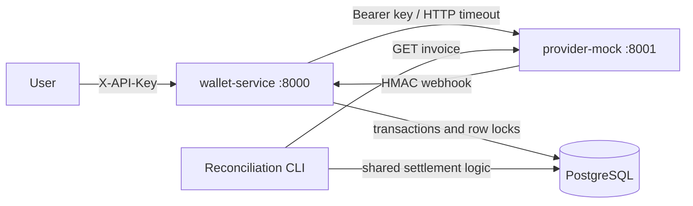

# LedgerLite

Two small Python services for USD deposits, transfers and credit purchases. The provider
is an in-memory payment simulator; the wallet persists balances and operation history in
PostgreSQL. Implements all required API operations plus reconciliation and rate limiting.

## Quick start

Prerequisites: Docker with Compose v2 or newer, Python 3.11+ for the one-time environment
generator, and free localhost ports 8000/8001. Docker Desktop must use Linux containers.

```console
python scripts/setup_env.py
docker compose up --build
```

The setup command creates a gitignored `.env` with three random local secrets. It never
overwrites existing configuration. `.env.example` documents the variables. After the first
build, `docker compose up` starts PostgreSQL, runs migrations and starts both services.
For background mode: `docker compose up -d --wait`.

- Wallet API and Swagger UI: http://localhost:8000/docs
- Provider API and Swagger UI: http://localhost:8001/docs
- Health: `/health` on either service. Wallet health checks PostgreSQL.

Create demo accounts (zero opening balances):

```console
docker compose exec wallet python -m ledgerlite.wallet.cli seed alice bob
```

Save the returned `account_id` and `api_key` locally. Keys are printed **once**, stored only
as SHA-256 digests in PostgreSQL, and never written by the seed command to a file. Repeating
a name preserves the account and does not rotate or reveal its key. To try again with new
keys, seed new names. Demo keys have 256 bits of randomness; these are not human passwords.

Stop without deleting data: `docker compose down`. PostgreSQL data is stored in a named
volume. Provider invoices are intentionally lost when its process restarts.

## Architecture and code



Stack: Python 3.12 in containers, FastAPI, Pydantic v2, SQLAlchemy 2.x, psycopg 3,
Alembic, HTTPX, pytest and Ruff. FastAPI keeps request validation and API documentation
small and explicit. Synchronous database operations run in worker threads; webhook
signature validation precedes a thread-dispatched database transaction.

```text
ledgerlite/common/     settings, money, signatures, error format, shared schemas
ledgerlite/provider/   minimal in-memory provider API
ledgerlite/wallet/     routes, schemas, models, services, provider client and CLI
migrations/           versioned Alembic schema
tests/                money, security, provider, PostgreSQL integration and concurrency
scripts/              environment setup and real HTTP smoke demonstration
.github/workflows/    PostgreSQL-backed CI
```

Dependencies are pinned in `requirements.lock` for Windows and Linux. Optional lock refresh:
`uv pip compile pyproject.toml --extra dev --universal --output-file requirements.lock`.

## Configuration

| Variable | Purpose / default |
| --- | --- |
| `POSTGRES_PASSWORD` | Random password generated for local Compose PostgreSQL |
| `PROVIDER_API_KEY` | Required shared provider bearer secret |
| `WEBHOOK_SECRET` | Required HMAC secret |
| `PROVIDER_TIMEOUT` | HTTP connect/read/write/pool timeout in seconds; default 5 |
| `RATE_LIMIT_ENABLED` | Default true; disable only for local load experiments/tests |
| `DATABASE_URL` | SQLAlchemy PostgreSQL URL; composed automatically inside Compose |
| `PROVIDER_URL` | Wallet-to-provider address; `http://provider:8001` |
| `CALLBACK_URL` | Exact permitted callback; `http://wallet:8000/v1/webhooks/provider` |
| `PROVIDER_PUBLIC_URL` | Prefix for mock payment URLs; `http://localhost:8001` |

The last four settings can be overridden in the process environment for running outside
Compose; edit the Compose service environment for custom container routing. Keep the
same callback in both services. No database port is published; APIs bind only to localhost.
Changing the database password in `.env` does not change an already initialized database.

## API examples

Commands below use Bash/curl (on Windows, use Git Bash/WSL or the Swagger UI).
Replace placeholders with the seed output. The provider key comes from the local `.env`.

```bash
export ALICE_KEY='<alice api_key>'
export BOB_ID='<bob account_id>'
export PROVIDER_API_KEY='<PROVIDER_API_KEY from .env>'

curl -s http://localhost:8000/v1/accounts/me -H "X-API-Key: $ALICE_KEY"

curl -s http://localhost:8000/v1/deposits \
  -H "X-API-Key: $ALICE_KEY" -H 'Content-Type: application/json' \
  -d '{"amount":"100.00"}'
```

Copy `invoice_id` from the deposit response. The response also contains `deposit_id`,
`status: pending` and a mock `pay_url` (there is no payment UI).

```bash
export INVOICE_ID='<returned invoice_id>'
curl -s "http://localhost:8001/invoices/$INVOICE_ID" \
  -H "Authorization: Bearer $PROVIDER_API_KEY"

curl -s "http://localhost:8001/invoices/$INVOICE_ID/simulate" \
  -H "Authorization: Bearer $PROVIDER_API_KEY" -H 'Content-Type: application/json' \
  -d '{"status":"paid","paid_amount":"100.00","deliver_webhook":true,"duplicate":true}'

curl -s http://localhost:8000/v1/transfers \
  -H "X-API-Key: $ALICE_KEY" -H 'Idempotency-Key: first-transfer' \
  -H 'Content-Type: application/json' \
  -d "{\"to_account_id\":\"$BOB_ID\",\"amount\":\"5.00\"}"

curl -s http://localhost:8000/v1/purchases \
  -H "X-API-Key: $ALICE_KEY" -H 'Content-Type: application/json' -d '{"credits":507}'

curl -s 'http://localhost:8000/v1/transactions?limit=20&offset=0' \
  -H "X-API-Key: $ALICE_KEY"
```

Expected Alice balances: 98.50 after deposit (1.50 fee), 93.50 after transfer, 45.33 and
507 credits after purchase. Bob receives 5.00. Repeat the transfer with the same key and
body to receive the same 201 response without another debit. Changing its amount returns
409. Keys are scoped to the sender; equivalent money representations normalize to cents.
Business-error responses such as insufficient funds are also saved; use a new key for a
new attempt after topping up. Validation/authentication/rate-limit errors are not saved.

All input money must be a nonnegative decimal **string**, with at most two decimal places
and at most 12 integer digits; deposits/transfers must be at least 0.01. No exponent notation,
signs or whitespace. Output USD values have exactly two decimal places; history debits have
a minus sign. Credits must be positive JSON integers (not booleans or strings), at most
1,000,000,000 per purchase. Self-transfers return 422. Amounts and balances are bounded by
999999999999.99 USD. Missing/invalid API keys return 401.

All API errors use `{"error":{"code":"...","message":"...","details":{}}}`. Invalid
requests return 422; missing resources 404; business conflicts/insufficient funds 409;
provider network/HTTP/invalid response errors 502; provider timeouts 504.

## Webhooks and reconciliation

The provider signs the exact UTF-8 body bytes:

```text
X-Timestamp: <Unix seconds>
X-Signature: sha256=<HMAC-SHA256(secret, timestamp_bytes + b"." + raw_body).hexdigest()>
```

The wallet accepts timestamps within 300 seconds in either direction and uses a constant-time
signature comparison. Missing, invalid, stale or too-far-future signatures return 401 before
body parsing. Duplicate event IDs and events for already final deposits return 200 with
`applied: false`. An unknown invoice returns 404 without consuming the event ID.

`paid` and `partially_paid` credit actual paid amount less the rounded 1.5% fee;
`expired` records closure with no credit even if paid_amount is nonzero. Every finalization
has one history entry. Repeating a simulation with the exact same final state redelivers
the same event ID; attempting to change a final state returns 409. Delivery failures are
reported in `webhook_delivery`; the state remains final, so retry the same simulation.

To simulate a lost webhook, use `deliver_webhook: false`, then:

```console
docker compose exec wallet python -m ledgerlite.wallet.cli reconcile --minutes 5
```

Use `--minutes 0` for an immediate demo. Each pending deposit is polled independently;
failures are counted and produce exit code 1, while other invoices continue. Settlement
shares the same locked transaction as webhooks, including when they race. The CLI is local
and privileged; no unauthenticated reconciliation endpoint is exposed.

The rate limiter accepts at most 30 authenticated wallet POST requests in a rolling 60-second
window per key. Excess requests return 429 and `Retry-After` seconds. Invalid business requests
and idempotency retries count. GETs and provider webhooks are exempt. PostgreSQL storage and
account locks coordinate across workers; at most 30 accepted request records remain per account.

## Verification

Build and run the full isolated test suite, schema drift check and lint:

```console
docker compose --profile test run --build --rm tests
```

Tests use a separate `postgres-test` database stored in tmpfs, never the demo database.
The fixtures refuse to truncate databases whose names do not end with `_test`.
Do not run concurrent pytest processes against the same test database.

Real HTTP demonstration (requires the application stack):

```console
docker compose exec wallet python scripts/smoke.py
```

This creates uniquely named demo accounts, performs deposits with duplicate/missing webhooks,
transfer replay/conflict, credit purchase, reconciliation and expiry, and checks both API and
database balances. It leaves demo data and prints no API keys.

Local Python development:

```console
python -m venv .venv
# Activate: .venv\Scripts\Activate.ps1 on PowerShell; source .venv/bin/activate on Bash
python -m pip install -r requirements.lock
python -m pip install --no-deps -e .
ruff check .
ruff format --check .
python -m pytest tests/test_money.py tests/test_security.py tests/test_provider.py -q
```

For local integration tests, set `DATABASE_URL` to a reachable dedicated PostgreSQL database
ending in `_test`, set `RATE_LIMIT_ENABLED=false`, run `alembic upgrade head`, then
`python -m pytest -q`. Settings read local `.env`; CI supplies test-only environment values.

Migrations run automatically before wallet startup. Manual inspection:

```console
docker compose exec wallet alembic current
docker compose exec wallet alembic check
```

GitHub Actions installs the same locked dependencies, checks Ruff/formatting, upgrades and
checks migrations, and runs pytest against PostgreSQL 16. The workflow has been prepared;
a hosted Actions run requires pushing to your chosen repository.

## Engineering decisions and trade-offs

1. **Decimal and NUMERIC(14,2).** Strings at the API boundary avoid float ambiguity. Fee and
   final credit price use ROUND_HALF_UP once, at the specified point. Database checks prohibit
   negative balances and credits even if application validation is bypassed.
2. **Row locks with stable account order.** Transfers lock both accounts by ID using
   PostgreSQL FOR NO KEY UPDATE. This excludes competing balance writers while allowing FK
   KEY SHARE locks held by inserted idempotency/history rows, preventing the deadlock found
   during testing. Each business operation, history and result commits together.
3. **Two independent settlement guards.** A unique event ID deduplicates delivery; a locked
   deposit's final state prevents crediting again under a different event ID or reconciliation.
4. **Transactional idempotency.** `(account_id, key)` is a database primary key. Conflicting
   inserts wait for the winner, then replay its saved JSON/status or report a payload conflict.
   No application-only check-then-insert race, cache or distributed lock is involved.
5. **Small synchronous core.** One database and two FastAPI apps keep the exercise reviewable.
   HTTP calls have explicit timeouts and run outside balance transactions. One shared image
   includes dev tools for easy reproducible testing; a production image could be smaller.
6. **Random local secrets and constrained mock.** API keys are high-entropy hashes, secrets
   stay in ignored environment configuration, API ports are localhost-only, the provider
   accepts only the configured callback to prevent arbitrary server-side HTTP requests.
7. **Database rate limiter and CLI reconciliation.** Avoids Redis and a background scheduler.
   Reconciliation runs on demand; row locks coordinate it with delivery. This is sufficient
   for the exercise, with explicit costs in database writes and per-account serialization.

## Known limitations and delivery status

- Provider storage is in memory, as required; use one provider process. Restart loses invoices.
  Persisted pending deposits whose invoices were lost require operator investigation.
- There is no distributed transaction with the provider. A timeout or DB failure after the
  provider accepted creation can leave an orphan invoice; deposits are not automatically retried.
  An early webhook before the deposit commit gets a retriable 404. A production integration
  would require provider-side idempotency plus durable request/recovery state.
- The provider delivers synchronously and has no retry queue or real payment page. Exact
  repeated simulation redelivers failed callbacks. Reconciliation is not scheduled automatically.
- Transfers have idempotency; deposits and purchases do not promise safe automatic retry.
  Idempotency/event/history records have no retention policy. Offset pagination can shift as
  new history arrives; there is no immutable snapshot cursor.
- This is a local exercise, without TLS termination, managed secrets, key rotation, operational
  monitoring or a complete double-entry accounting system. Do not expose the mock publicly.
- The pinned Starlette TestClient emits an upstream HTTPX deprecation warning; tests pass.
- All mandatory API behavior and both bonuses are implemented. See `ACCEPTANCE.md` for actual
  verification evidence. Remote CI and repository access remain to be verified after publication.
- `AI_NOTES.md` discloses actual AI involvement and observed mistakes; the developer should
  review it and add only their own real decisions/time before submitting.
